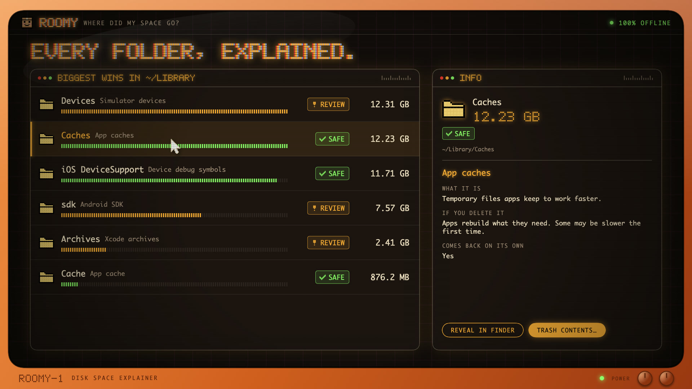

# Roomy


A free, open-source Mac app that shows where your disk space went, explains what each big folder is, and tells you whether it's safe to delete. Styled like a retro CRT space console, with pixel art.

[](https://github.com/TusharKarkera22/Roomy/releases/download/v0.1.0/roomy-launch.mp4)

*Click to watch the 22-second launch video.*

Most disk tools show sizes. Roomy also answers the next question: *what is this, and what happens if I delete it?*

- **100% offline.** No network code, no account, no tracking.
- **Your choice of access.** Give Full Disk Access for a complete scan, or let macOS ask folder by folder. Folders you don't allow are marked Locked.
- **One scan, then instant browsing.** Roomy measures everything once, then opens any folder instantly.
- **Report** with the biggest wins: what's Safe to clean, what's worth a look, and what macOS kept locked.
- **File-level breakdown.** "Largest files inside" lists the biggest files anywhere under a folder, however deep.
- **Every item explained**: what it is, which app it belongs to, what happens if you delete it, whether it comes back on its own, and the better way to clean it (for example `docker system prune -a` instead of deleting Docker's disk).
- **Find duplicates**: identical files of 1 MB or more, compared by their full contents.
- **Trash first.** Roomy moves things to the Trash, never deletes them directly, and refuses to trash top-level folders like `~/Library` or `~/Documents`. For Safe folders macOS expects to exist (like `~/Library/Caches`) it trashes what's inside and keeps the folder. The only permanent action is **Empty Trash**, which asks Finder to do it after a clear warning.

## Install

Requires macOS 14 or later and Xcode (or the Swift toolchain).

```bash
git clone https://github.com/TusharKarkera22/Roomy.git && cd Roomy
scripts/build-app.sh
open build/Roomy.app
```

On first launch Roomy asks how you want to give access. For Full Disk Access it opens System Settings and shows Roomy in Finder: drag it into the list and switch it on. macOS only lists apps you add yourself, and treats every new self-built copy as a new app, so switch it on again after rebuilding.

## The knowledge base: `rules.json`

All explanations live in [`Sources/RoomyCore/rules.json`](Sources/RoomyCore/rules.json), a plain list anyone can edit. Each rule looks like:

```json
{
  "id": "xcode-derived-data",
  "paths": ["~/Library/Developer/Xcode/DerivedData*"],
  "title": "Xcode build data",
  "owner": "Xcode",
  "what": "Build output and code indexes for your Xcode projects.",
  "ifDeleted": "Xcode rebuilds it the next time you build. The first build is slower.",
  "verdict": "safe",
  "comesBack": true,
  "howToClean": "optional: a better way than deleting the folder"
}
```

- `paths` are shell-style patterns: `*` matches anything, including `/`, and `~/` is the home folder.
- **The first matching rule wins**, so put specific rules above generic ones (Claude's `vm_bundles` sits above the generic `Application Support` rule).
- `verdict`: `safe` (rebuilt or re-downloaded, nothing of yours lost), `review` (might hold something you want), `keep` (don't trash it; use `howToClean`).

### Contributing a rule

Found a folder Roomy calls Unknown? Add a rule, add its path to `testSpecificRulesWinOverGenericOnes` in the tests, run `swift test`, and open a pull request. Only write what you're sure of: people delete things based on these words.

## Develop

```bash
swift test        # rule matching, trash guard, duplicates, sizing
swift run Roomy   # run without building the .app
open -n build/Roomy.app --args --scan ~/Library   # skip the welcome screen and scan one folder
```

`RoomyCore` has the logic (rules, the scan tree, trash safety, duplicates). `Roomy` is the SwiftUI app. All pixel art is drawn from text in `Sources/Roomy/Sprites.swift`, and the app icon is rendered from it by `Roomy --make-icon` during `scripts/build-app.sh`.

Files under 1 MB are counted per folder rather than listed, which keeps a whole-disk scan small enough to hold in memory.

## Not yet

- An AI explanation for folders that no rule covers yet.
- Hard links and APFS clones are counted as duplicates even though they share space.
- The app builds for this Mac's chip only and is ad-hoc signed, so other Macs will show a Gatekeeper warning.

## License

MIT
