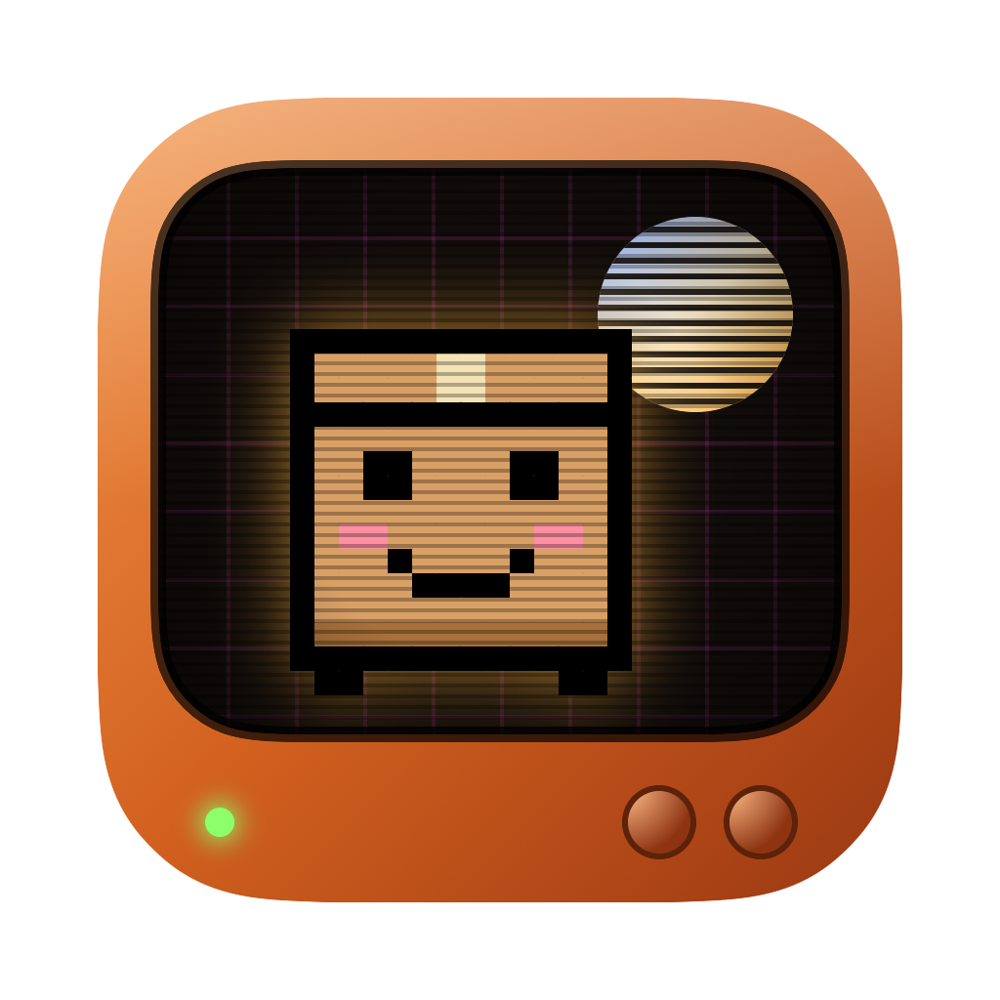
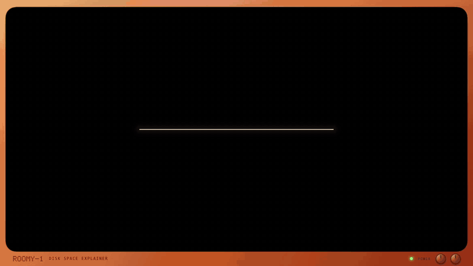

# Roomy: free Mac disk space analyzer that explains what's safe to delete



[](https://github.com/TusharKarkera22/Roomy/releases/latest)
[](https://github.com/TusharKarkera22/Roomy/releases)

[](LICENSE)

Roomy is a free, open-source Mac app that finds what's taking up space on your Mac, explains what each big folder is in plain words, and tells you whether it's safe to delete. It covers caches, Xcode DerivedData and simulators, `node_modules`, Docker and VM disks, local AI models, iPhone backups and duplicate files. It runs 100% offline and is styled like a retro CRT space console, with pixel art.

[](https://github.com/TusharKarkera22/Roomy/releases/download/v0.1.0/roomy-launch.mp4)

*Click for the full launch video with sound.*

Most disk tools show sizes. Roomy also answers the next question: *what is this, and what happens if I delete it?*

- **100% offline.** No network code, no account, no tracking.
- **Your choice of access.** Give Full Disk Access for a complete scan, or let macOS ask folder by folder. Folders you don't allow are marked Locked.
- **One scan, then instant browsing.** Roomy measures everything once, then opens any folder instantly.
- **Report** with the biggest wins: what's Safe to clean, what's worth a look, and what macOS kept locked.
- **File-level breakdown.** "Largest files inside" lists the biggest files anywhere under a folder, however deep.
- **Every item explained**: what it is, which app it belongs to, what happens if you delete it, whether it comes back on its own, and the better way to clean it (for example `docker system prune -a` instead of deleting Docker's disk).
- **Find duplicates**: identical files of 1 MB or more, compared by their full contents.
- **Trash first.** Roomy moves things to the Trash, never deletes them directly, and refuses to trash top-level folders like `~/Library` or `~/Documents`. For Safe folders macOS expects to exist (like `~/Library/Caches`) it trashes what's inside and keeps the folder. The only permanent action is **Empty Trash**, which asks Finder to do it after a clear warning.

## Download

**[Download Roomy 0.1.0 (.dmg, 2 MB)](https://github.com/TusharKarkera22/Roomy/releases/latest/download/Roomy-0.1.0.dmg)** for macOS 14 or later, on Apple Silicon or Intel.

Open the DMG and drag Roomy onto Applications. Roomy isn't notarized by Apple yet, so the first time:

1. Open Roomy. macOS says it can't check it for malware: click **Done**.
2. Open **System Settings › Privacy & Security**, scroll down, and click **Open Anyway** next to Roomy.

You only do this once. If you'd rather not, build it yourself below; it's the same code.

## Build from source

Requires macOS 14 or later and Xcode (or the Swift toolchain).

```bash
git clone https://github.com/TusharKarkera22/Roomy.git && cd Roomy
scripts/build-app.sh
open build/Roomy.app
```

`scripts/make-dmg.sh` builds the same DMG as the release.

On first launch Roomy asks how you want to give access. For Full Disk Access it opens System Settings and shows Roomy in Finder: drag it into the list and switch it on. macOS only lists apps you add yourself, and treats every new self-built copy as a new app, so switch it on again after rebuilding.

## FAQ

**What is taking up space on my Mac?**
Usually things you never see: app caches in `~/Library/Caches`, Xcode build data and simulators, `node_modules` folders, Docker and virtual machine disks, local AI models (Ollama, LM Studio, Hugging Face), old iPhone backups and duplicate downloads. Roomy scans your home folder in seconds and lists the biggest ones first, with an explanation for each.

**Is it safe to delete `~/Library/Caches` on a Mac?**
The contents, yes: apps rebuild their caches as needed, though some may be slower the first time. The folder itself should stay, so Roomy's **Trash contents** button keeps the folder and moves what's inside to the Trash. Quit apps first to clear more.

**How do I free up space from Xcode?**
`DerivedData` and `iOS DeviceSupport` are Safe: Xcode rebuilds or re-copies them. Simulator devices and archives are worth a look first. Roomy points you to `xcrun simctl delete unavailable` for simulators of old iOS versions.

**Can I delete `node_modules`, Docker images or Ollama models?**
`node_modules` comes back with `npm install`. For Docker, don't delete its disk file; run `docker system prune -a` instead. For Ollama, `ollama rm <model>` removes one model at a time. Roomy shows the right command for each.

**How is Roomy different from DaisyDisk, GrandPerspective or CleanMyMac?**
Disk maps show you what's big. Roomy also tells you what each folder is, what happens if you delete it, and whether it comes back on its own. It's free, open source, runs offline, and only removes things when you click.

**Does Roomy upload anything?**
No. Roomy has no network code at all. It reads file names and sizes on your Mac and nothing leaves it.

## The knowledge base: `rules.json`

All explanations live in [`Sources/RoomyCore/rules.json`](Sources/RoomyCore/rules.json), a plain list anyone can edit. Each rule looks like:

```json
{
  "id": "xcode-derived-data",
  "paths": ["~/Library/Developer/Xcode/DerivedData*"],
  "title": "Xcode build data",
  "owner": "Xcode",
  "what": "Build output and code indexes for your Xcode projects.",
  "ifDeleted": "Xcode rebuilds it the next time you build. The first build is slower.",
  "verdict": "safe",
  "comesBack": true,
  "howToClean": "optional: a better way than deleting the folder"
}
```

- `paths` are shell-style patterns: `*` matches anything, including `/`, and `~/` is the home folder.
- **The first matching rule wins**, so put specific rules above generic ones (Claude's `vm_bundles` sits above the generic `Application Support` rule).
- `verdict`: `safe` (rebuilt or re-downloaded, nothing of yours lost), `review` (might hold something you want), `keep` (don't trash it; use `howToClean`).

### Contributing a rule

Found a folder Roomy calls Unknown? Add a rule, add its path to `testSpecificRulesWinOverGenericOnes` in the tests, run `swift test`, and open a pull request. Only write what you're sure of: people delete things based on these words.

## Develop

```bash
swift test        # rule matching, trash guard, duplicates, sizing
swift run Roomy   # run without building the .app
open -n build/Roomy.app --args --scan ~/Library   # skip the welcome screen and scan one folder
```

`RoomyCore` has the logic (rules, the scan tree, trash safety, duplicates). `Roomy` is the SwiftUI app. All pixel art is drawn from text in `Sources/Roomy/Sprites.swift`, and the app icon is rendered from it by `Roomy --make-icon` during `scripts/build-app.sh`.

Files under 1 MB are counted per folder rather than listed, which keeps a whole-disk scan small enough to hold in memory.

## Not yet

- An AI explanation for folders that no rule covers yet.
- Hard links and APFS clones are counted as duplicates even though they share space.
- Developer ID signing and Apple notarization, which would remove the "can't check for malware" step on first open.

## License

MIT
